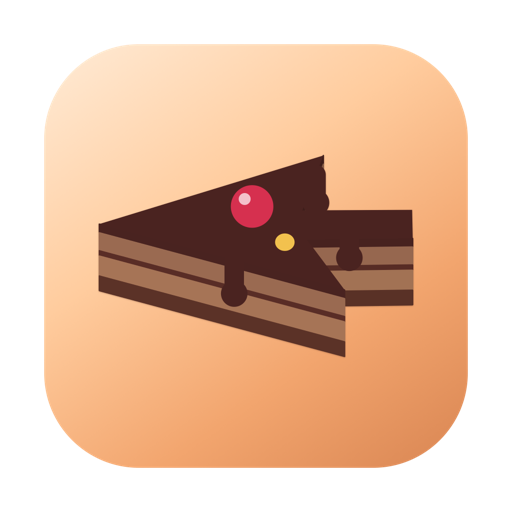
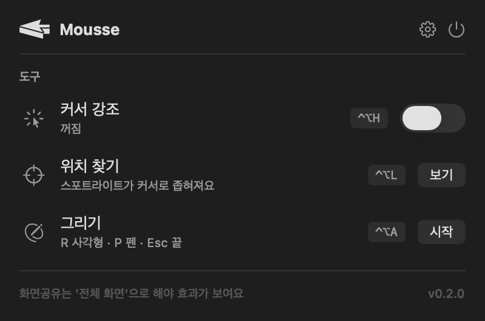

<p align="center">
  
</p>

<h1 align="center">Mousse</h1>

<p align="center">
  화면공유·발표할 때 켜두는 가벼운 macOS 메뉴바 커서 도구<br>
  <i>mouse + mousse — 커서 모양 초코 무스 케이크</i>
</p>

<p align="center">
  
</p>

## 기능 로드맵

| 단계 | 기능 | 기본 단축키 | 권한 | 상태 |
|---|---|---|---|---|
| 1 | 커서 강조 on/off (채움/링, 색·크기·투명도) | ⌃⌥H | 없음 | ✅ |
| 1 | 위치 찾기 (스포트라이트가 커서로 좁혀짐) | ⌃⌥L | 없음 | ✅ |
| 2 | 그리기 모드 (R 사각형 · P 펜, 그린 뒤 3초 후 페이드아웃, Esc로 모두 지우고 끝) + 설정창(단축키 변경) | ⌃⌥A | 없음 | ✅ |
| 3 | 타이핑 표시 (영문·단축키 조합 → 한글 조합) | 미정 | 입력 모니터링 | |
| 4 | 돋보기 (누르고 있는 동안 확대) | ⌃⌥Z (예정) | 화면 기록 | |

> 효과는 별도 오버레이 창에 그려지므로 Zoom·Meet에서 **창 단위가 아니라 "전체 화면" 공유**를 해야 송출된다.

### 그리기 모드

⌃⌥A로 켜면 모든 화면이 그리기 면이 된다(다른 앱 클릭은 막힘). 모드 안에서 **R** 사각형, **P** 펜,
**Esc**(또는 ⌃⌥A 다시)로 끝내면 그린 것도 모두 사라진다. 기본값은 "다 그린 뒤 3초 후 하나씩
페이드아웃"이고 설정창 › 그리기에서 끄거나 시간을 바꿀 수 있다. ⌘-Tab으로 다른 앱으로 가도 모드가 끝난다.

모드 동안 Mousse가 잠깐 활성 앱이 된다(키 입력·커서 모양 때문). 끝나면 직전 앱으로 포커스를 돌려준다.

## 구조

```
Mousse/
├── MousseApp.swift              진입점 (LSUIElement 메뉴바 앱)
├── Core/
│   ├── AppModel.swift           설정·단축키·오버레이 연결 (단일 상태)
│   ├── AppSettings.swift        UserDefaults 저장 설정
│   └── Hotkeys.swift            Carbon 전역 단축키 (권한 불필요, press/release)
├── Overlay/
│   ├── OverlayController.swift  화면별 오버레이 관리, 마우스 추적, 애니메이션 구동
│   ├── OverlayWindow.swift      클릭 통과 투명 패널(그리기 모드에선 입력 받음) + Core Animation 레이어
│   ├── DrawingCanvas.swift      화면별 사각형·펜 레이어, 도형별 페이드아웃
│   ├── DrawingHint.swift        도구 안내 알약 + 도구별 커서
│   └── FindCursorAnimation.swift 위치 찾기 타임라인(순수 계산)
├── MenuBar/                     팝오버 UI: 도구 on/off·실행만 (Soundwich 디자인 시스템 준수)
│   └── DebugSnapshot.swift      (Debug 전용) 팝오버 화면을 창으로 띄워 캡처
└── Settings/
    ├── SettingsWindowController.swift  ⚙︎로 여는 설정창 (툴바 탭: 커서/그리기/단축키/일반)
    ├── SettingsView.swift              탭 내용 (SwiftUI)
    ├── HotkeyRecorder.swift            단축키 녹화 (녹화 중엔 Mousse 단축키 일시 해제)
    └── LoginItemManager.swift
```

- 아무 효과도 없을 땐 오버레이를 내리고 마우스 추적도 멈춘다 → 유휴 시 CPU 0에 가깝게.
- 디자인 규칙은 `../Soundwich/docs/DESIGN_SYSTEM.md`를 따른다.

## 빌드

```bash
./scripts/run_dev.sh      # xcodegen → Debug 빌드 → Apple Development 서명 → ~/Applications 설치 → 재실행
./scripts/make_icons.sh   # 아이콘(메뉴바 PDF + 앱 아이콘) 다시 그리기 — 형태·색은 scripts/render_icons.swift 한 곳
```

Xcode는 `DEVELOPER_DIR`로 지정해서 쓴다(시스템 기본은 Command Line Tools). Debug 빌드는
`ENABLE_DEBUG_DYLIB=NO`로 빌드해야 재서명 후 실행된다.

### 키보드·마우스 안 건드리고 테스트하기 (Debug 빌드 전용)

```bash
swift scripts/debug_trigger.swift highlightOn    # highlightOff | find | menuShow | menuHide
swift scripts/debug_trigger.swift drawDemo       # 입력을 뺏지 않고 사각형+펜을 그려 페이드까지 재생
swift scripts/debug_trigger.swift settingsShow:1 # 설정창 탭(0~3)을 다른 창 뒤에 띄움 | settingsHide
swift scripts/debug_trigger.swift dump:/tmp/m.txt # 상태(그리기 여부·Esc 등록·활성 앱 등) 파일로
screencapture -x -C shot.png                     # 커서 포함 캡처
```

`menuShow`·`settingsShow`는 창을 다른 창들 뒤에 띄우므로 `screencapture -l <windowID>`로 찍을 수 있다.
`drawOn`/`drawOff`/`drawRect`/`drawPen`은 실제 그리기 모드라 그동안 포커스와 클릭을 가져간다 — 짧게만 쓴다.

고정된 개발 서명으로 빌드해야 3·4단계의 입력 모니터링·화면 기록 권한이 빌드마다 풀리지 않는다.
